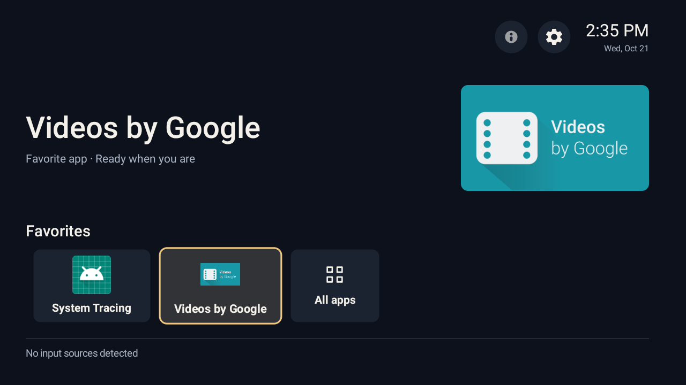

# QuasarTV Launcher

A native Android TV launcher for favorite apps, installed apps and TV inputs. No recommendations, ads, telemetry or network-dependent interface.



## Build

Production build and signing on this workstation:

```bash
./gradlew testReleaseUnitTest assembleRelease lintRelease
bash scripts/sign-release.sh
adb -s 192.168.18.65:5555 install -r app/build/outputs/apk/release/app-release.apk
adb -s 192.168.18.65:5555 shell cmd package set-home-activity --user 0 com.quasartv.launcher/.MainActivity
```

Release uses R8/resource shrinking and is not debuggable. Private signing files live in `~/.config/quasartv` outside this repository; retain a private backup of that directory for future updates. The signing lineage upgrades the existing debug installation on Android 9 without clearing favorites. `scripts/sign-release.sh` requires those existing keys and Android SDK Build Tools 35.0.0. It does not generate replacement keys.

Development build:

```bash
./gradlew testDebugUnitTest assembleDebug assembleDebugAndroidTest lintDebug
adb -s 192.168.18.65:5555 install -r app/build/outputs/apk/debug/app-debug.apk
```

APK: `app/build/outputs/apk/debug/app-debug.apk`. Installing does not change the selected default Home app.

## Remote controls

- D-pad moves focus. OK launches the selected favorite or active input; inactive inputs stay grey and do not launch.
- All apps at the end of favorites opens the app library. Menu opens favorite actions; Choose favorites mode toggles a favorite with OK.
- Up from the shelf reaches the round launcher settings button (i). Right reaches the separate TV settings button (gear). Both open directly; Down returns to content.
- Back returns from launcher sections to Home and from the header to content.
- Repeated Home presses keep the existing Home views and focused item. Repeated Back on Home content also keeps focus; returning from a section hands focus directly to content without flashing a header button.
- Empty Home offers Browse apps. Launcher settings contains appearance, motion, spacing, favorites management and About.
- About shows “Made for the moments in between.”, Ravhi Rizaldi and a plain-text GitHub address. Ten clicks on the card reveal the bundled photo; Back or Close returns to the card.

## Behavior

Home uses the screen width without a sidebar, logo, launcher title or redundant launch button. The featured app's installed banner or higher-density icon has 10dp rounded corners and no launcher frame. Its fitted image, clock/date and shelf share a 24dp end inset; it remains stable when moving focus to settings or inputs and back. App artwork is loaded on one worker with a bounded 1 MiB cache; tile icons remain bounded at 128 pixels.

Input buttons appear only below favorites, without a separate Inputs label. Home uses a fixed vertical viewport; only the favorite and source shelves scroll horizontally. `TvInputManager` callbacks update source state/discovery while the launcher is visible. Custom input names come from Android TV, including PlayStation on the test TV. All detected sources remain visible. Connected switchable sources are active; standby, disconnected, unknown and unsupported sources are grey but remain focusable to inspect. OK on an inactive source does nothing. The tuner's always-connected service does not establish passthrough support. Direct passthrough switching uses Android's TV URI; verified input settings are a fallback when available.

Input buttons use PatchWall's original HDMI/AV/TV glyphs and icon-over-label composition. Header info/settings are extracted native vector paths. Small copied resources work without PatchWall installed; no foreign APK or network UI is loaded. [Extraction evidence and provenance](artifacts/xiaomi-launcher/PROVENANCE.md).

Launcher transient messages and toasts are removed. Discovery problems remain visible in the relevant screen; operation failures are logged. Favorites, appearance and focus use local preferences.

Apps and Settings leave 24dp below the fixed header: 12dp clear beneath the focused circles, then a soft static 12dp shadow. The separator uses a small drawable with no live blur or animated elevation. The secret photo is a bundled 539×720 JPEG, decoded on demand in RGB_565 and released when its viewer closes; it needs no network access.

## Runtime target

- Xiaomi Mi TV 4A class, approximately 1 GB RAM; primary test device `192.168.18.65:5555`, Android 9, 1280x720.
- minSdk 28, compileSdk/targetSdk 35.
- Kotlin, native Android Views/XML. No Compose, Flutter, WebView UI or backend.
- The wider emulator matrix is deferred while testing the physical television.

## Device checks

```bash
adb -s 192.168.18.65:5555 install -r app/build/outputs/apk/androidTest/debug/app-debug-androidTest.apk
adb -s 192.168.18.65:5555 shell am instrument -w -e variant xiaomi-tv -e skipExternalApps true com.quasartv.launcher.test/com.quasartv.launcher.VisualSmokeTest
```

The native check covers header controls, stable borderless artwork through repeated focus changes, the terminal All apps outline, library scrolling, settings, all custom-named input states, safe inactive OK, simulated source callbacks, zero/one/three/twelve favorites, a 25-app fixture and motion modes. Repeated Down at inputs must preserve focus, header pixels and Home geometry, including long-title and empty-favorites fixtures. Test fixtures never enter the launcher APK or saved favorites. The check changes background/focus preferences; back up app preferences before running it on a personal TV. Screenshots are written below the launcher's external files directory in `visual-smoke`.

The command explicitly excludes streaming-app Back behavior: Apple TV retained foreground in an earlier hardware run. Native TV settings opening and return are tested separately. A simulated callback does not prove physical HDMI hotplug behavior.

`./gradlew assembleDebugAndroidTest -PtestRunner=com.quasartv.launcher.HomeBackFocusTest` builds a focused, platform-only Back/Home regression runner. To instrument an installed release it must be signed with the same release certificate. It checks rapid Back pairs on favorites/inputs, header return, Settings return and repeated Home intents while recording every focus transition. App and input discovery run as separate background scans; unchanged results leave the current screen and focus untouched, and live input connection changes redraw only the source shelf. App labels and icons are cached until the package is updated. Pause/resume during an in-place Home intent does not rebuild the screen.

See [implementation notes](artifacts/REDESIGN.md) and [physical TV validation](artifacts/xiaomi-tv/REPORT.md) for current screenshots, build output, memory measurements and limitations.
